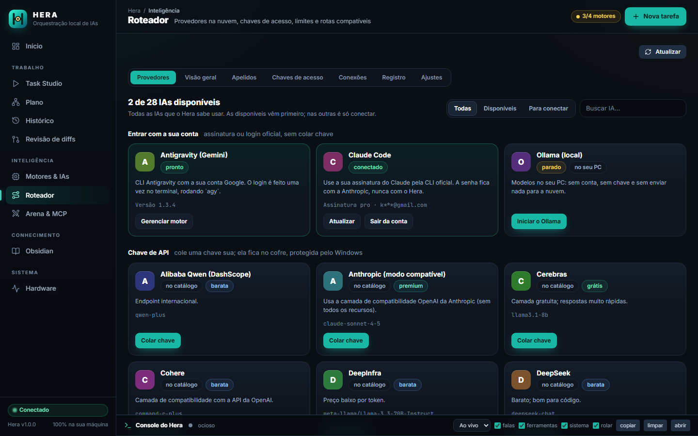
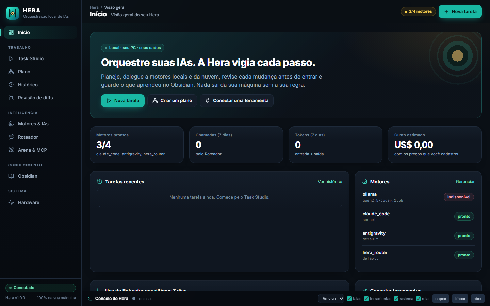
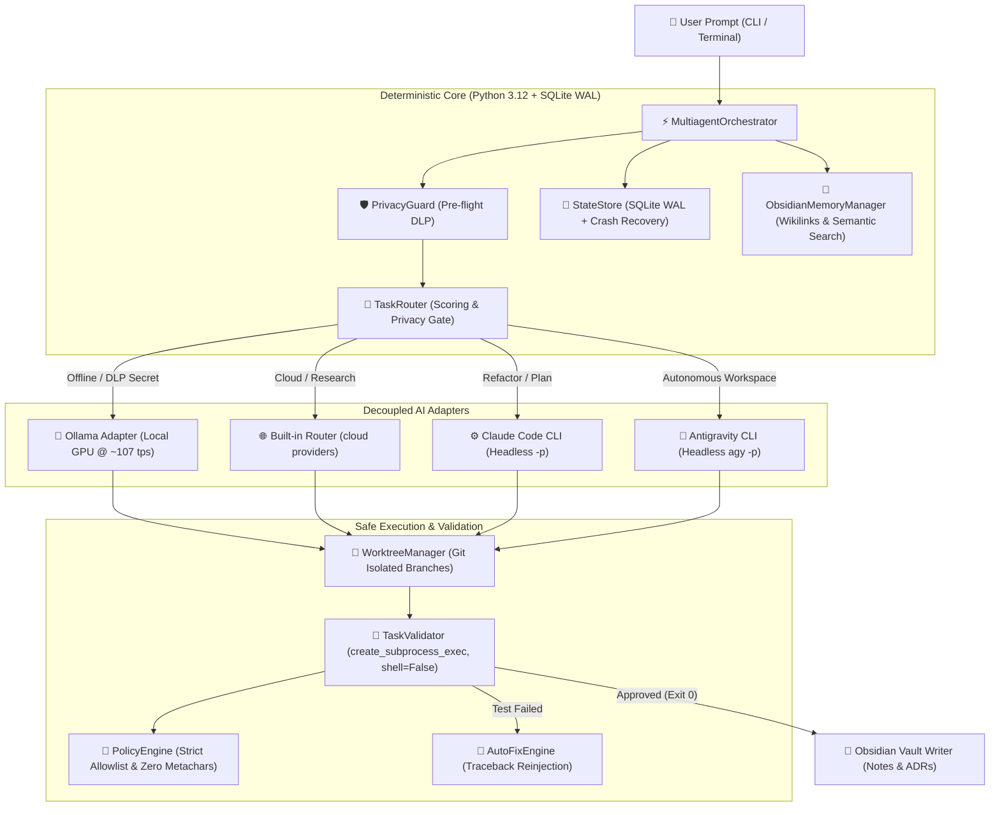

<div align="center">


# HERA
### Local AI orchestration, under your control — Windows

[](https://python.org)
[](https://github.com/Kaio-Comk/hera-multiagent)
[](https://github.com/Kaio-Comk/hera-multiagent)
[](https://github.com/Kaio-Comk/hera-multiagent)
[](https://github.com/Kaio-Comk/hera-multiagent)
[](https://github.com/Kaio-Comk/hera-multiagent)
[](https://github.com/Kaio-Comk/hera-multiagent)
[](https://github.com/Kaio-Comk/hera-multiagent)
[](https://github.com/Kaio-Comk/hera-multiagent)
[](https://opensource.org/licenses/MIT)

**Connect, route, validate, and orchestrate Ollama, Claude Code CLI, Antigravity CLI, the built-in Router, and Obsidian as permanent memory — featuring a native Python OpenAI-compatible gateway (`/v1`), RTK Token Saver, AST Repo-Map for 4GB VRAM GPUs, Human-in-the-Loop (HITL) Visual Diff Review, Model Context Protocol (MCP) server & tool catalog, and Multi-Model Arena benchmarks under deterministic guardrails.**

[Key Features](#-key-features) • [Panel](#-mission-control-web--desktop-gui) • [Architecture](#-architecture) • [Security Model](#-hardened-security-model) • [Benchmark](#-hardware-benchmark) • [Quickstart](#-quickstart) • [CLI Cheatsheet](#-cli-cheatsheet)

</div>

---

## 💡 The Core Philosophy

> **Strictly separate AI intelligence from deterministic execution.**  
> LLMs handle reasoning, planning, and code drafting. The Python/SQLite orchestrator deterministically handles task queuing, structured subprocess execution (`shell=False`), git worktree isolation, pre-flight data loss prevention (DLP), objective test runners, and atomic state recovery.  
> **No AI model can execute unrestricted shell commands or leak credentials to the cloud.**

---

## ⚡ Key Features

* **🧠 4 Decoupled AI Engines:**
  * **Ollama (Local GPU):** Blazing-fast 100% offline inference on consumer GPUs (GTX 1650 Super @ **~107 tokens/s**).
  * **Built-in Router:** a catalog of cloud providers (API key or sign-in with your account), key rotation, tiers and automatic fallback between providers, inside Hera itself (no external process).
  * **Claude Code CLI:** Headless non-interactive `-p` subprocess for complex codebase refactoring.
  * **Antigravity CLI (`agy`):** Headless autonomous workspace operations with full tool support.
* **🔀 Directed Acyclic Graph (DAG) Scheduler:**
  * Multi-task concurrency with **Kahn's topological sorting**.
  * Asyncio semaphore concurrency control.
  * Instant **cascade cancellation**: if a parent dependency fails, downstream tasks abort safely.
* **🌳 Isolated Git Worktrees:**
  * Concurrent coding tasks execute on isolated worktree branches, preventing file collisions.
  * Strict path containment: regex-validated task IDs preventing path traversal.
* **🛡️ Hardened Security & Pre-Flight DLP:**
  * **Zero-Shell Execution:** Replaced all shell execution with `asyncio.create_subprocess_exec` (`shell=False`) and structured `argv` parsing via `shlex`.
  * **Data Loss Prevention (`PrivacyGuard`):** Detects OpenAI, Anthropic, GitHub, AWS, JWT, and password patterns. Blocks cloud routing and **fails-closed to local Ollama** whenever secrets or offline flags are detected.
  * **Process Tree Termination:** Clean teardown of orphan process trees on Windows using `taskkill /F /T`.
* **🔁 Autonomous Self-Healing Loop:**
  * Deterministic test validation with objective exit code check (`exit code 0`).
  * Auto-fix engine reinjecting traceback and test failures back into the model (capped at 2 retries).
* **📚 Permanent Second-Brain Memory (Obsidian Vault):**
  * Reads conventions and injects context from `[[wikilinks]]`.
  * Semantic note retrieval and SHA-256 deduplication.
  * Automatically records Architectural Decision Records (ADRs) and execution logs.
* **💾 Resilient Persistence & Crash Recovery:**
  * SQLite WAL mode (`PRAGMA journal_mode = WAL;`, `foreign_keys = ON;`).
  * Startup crash recovery detecting orphaned tasks and transitioning them to `FAILED` with audit events in a single atomic transaction.
* **🖥️ Mission Control Web & Desktop Interface:**
  * FastAPI backend with full REST API and real-time WebSocket log streaming.
  * Dark-mode responsive dashboard with 5 specialized operational tabs.
  * Direct 1-click model download (`ollama pull`) with streaming progress bar.
  * Native Windows Desktop Window (`pywebview`) or browser interface.

---

## 🖥️ Live console (the Hera "talks" while it works)

A docked **Console do Hera** (bottom of every tab) narrates a plan or task in real time: each step starting (engine / model / why), what the agent says, the tools it calls (`Bash: ls -la`, file reads...) and their results, "still working (4min 05s)" heartbeats, and each step ending with duration, tokens and cost, or the reason it failed. It uses the CLIs' native `stream-json` output (Claude Code, Antigravity) and streaming for Ollama.

- Filters (speech / tools / system), copy, clear, auto-scroll; it survives page reloads.
- Every run is saved to `data/runs/<id>.jsonl` (last 40) so you can reopen it from the console's run picker, even after restarting Hera. Texts go through the secret filter first.
- `data/logs/hera.log` keeps only summaries (no conversation content).

## 🧱 UI without CDNs

The panel loads everything from the server itself (`/static`: compiled Tailwind CSS, Lucide, marked, DOMPurify and the Inter/JetBrains Mono fonts), so it works offline and ships with a strict Content-Security-Policy. Static files are public read-only; every API route still needs the token. After changing Tailwind classes in `web/index.html`, regenerate with `python tools/ui/build_ui.py` (needs Node.js).

## 🔌 Start/stop local services from the panel

In **Motores & IAs**, the Ollama card has **Iniciar / Parar** buttons. The commands are fixed (nothing comes from the request), the process starts hidden on loopback with a minimal environment (no API keys), and **Parar** only stops what Hera itself started (whole process tree). A service opened elsewhere (tray icon, another terminal) is shown as running but is left alone. Logs go to `data/logs/`. Services started by Hera keep running if you close Hera.

## 📓 Obsidian inside Hera

The **Obsidian** tab opens your whole vault (auto-detected from the folder that has `.obsidian`, or `general.vault_root` in `config.yaml`): file tree, search, tags, **editor with live preview** (wikilinks, callouts, tasks, images), backlinks/outgoing links/outline, daily note, note graph, create / rename (rewriting `[[links]]`) / delete (to `.trash`), and **✨ Hera** actions (summarize, continue, improve selection, suggest tags, ask about the note).

- Safe by design: paths are contained to the vault, hidden folders (`.obsidian`, `.git`, `.trash`) are untouchable, only UTF-8 `.md` up to 2 MiB is editable, writes are atomic, and a hash check stops Hera from overwriting a note you changed in Obsidian.
- Note previews are sanitized (DOMPurify); external images are blocked; SVG is never served.
- AI actions go through the privacy gate: Offline mode or a secret in the note forces local Ollama; if the engine is not local you must confirm before the text leaves your PC. Nothing is written until you click *Inserir* and save.

## 🌐 Built-in Router

The **Roteador** tab is a catalog of every AI Hera can use, available ones first: **your account** (Claude Code via its official `claude auth login`, Antigravity, local Ollama, your own OAuth apps), **sign-in in one click** (OpenRouter, official PKCE flow that hands Hera a key of yours), and **API-key** providers (50 ready-made ones plus any HTTPS OpenAI-compatible API; 25 of them came from the 9router provider registry and are not yet tested live). Filter by *Available / To connect* and search by name. Which AI handles each task is decided by the planner model, not by fixed chains: there are no combos. Use `provider/model` or an alias as the model from the Plan tab or any tool pointed at `http://127.0.0.1:8000/v1`. No external process or port is needed (engine `hera_router`).

<p align="center"></p>

- **Keys:** paste them in the panel (they go to a local vault protected by Windows DPAPI, never shown again) or, if you prefer, set an environment variable (`setx GROQ_API_KEY "..."`, name must end in `_API_KEY`). Pasting/enabling needs the human approval code.
- **Addressing:** use an alias, `provider/model` (e.g. `groq/llama-3.3-70b-versatile`) or `default` as the model in any OpenAI-compatible tool pointed at `http://127.0.0.1:8000/v1` (the card "Conectar suas ferramentas" shows the URL and key).
- **Usage:** calls, errors, tokens and latency per provider/model/day (metadata only, never the conversation).
- **Discovery:** "Buscar modelos" asks the provider for its model list; any HTTPS OpenAI-compatible API can be added as a custom provider.
- **Aliases** (`codigo` → `deepseek/deepseek-chat`) let you change the target without touching your tools.
- **Resilience:** per-provider circuit breaker (pauses after N consecutive failures, doubling up to 10 min, with a "retry now" button), requests/minute, requests/day and tokens/day limits, and priority inside a tier. Tier order is editable.
- **Access keys for external tools:** one key per tool (Cursor, Cline, scripts...). A key only opens `/v1`, can be limited to models (`groq/*`), requests per minute and tokens per day, and is shown once (only a salted hash is stored). Creating/re-enabling needs the approval code.
- **Dashboard:** usage, success rate, p50/p95 latency, estimated cost (prices *you* enter, local/free = 0), per provider/model/client/day, provider health, and a live call log (metadata only; fallback attempts grouped).
- **Several accounts per provider:** "Add another account" appends a key to the provider's vault list (up to 20, each shown as its last 4 characters with a ✕ to remove just that one); requests rotate between them and a key that hits its limit rests while the others serve. "Replace all" still swaps the whole list.
- **Extra headers per provider** (`headers:` in `config.yaml` or the provider's detail panel), e.g. `HTTP-Referer`/`X-Title`; `Authorization`, `Content-Type`, `Host` and other framing headers are refused. **Quota:** `x-ratelimit-*` headers are read from every response and shown in the panel; a key whose request quota reaches 0 with a known reset rests until then.
- **Catalog refresh:** `tools/sync_9router_catalog.py` regenerates `app/gateway/presets_extra.py` (new OpenAI-compatible providers + newer model lists) from the 9Router registry (MIT; data only, no code, no OAuth client ids).
- **More:** 50 ready-made providers, RTK token saver toggle with savings counter, export/import of the router config (never includes keys; imported providers arrive disabled).
- The privacy gate applies to every request: secrets or Offline mode keep cloud providers out, and the local Ollama stays as the plan B.

### Formats and modalities (ported from 9router, MIT)

The same Router speaks more than `chat/completions`. Everything below goes through the same privacy gate, access keys, limits, fallback and usage log; the **Roteador → Conexões** tab lists the addresses.

| Route | Format | Typical client |
|---|---|---|
| `POST /v1/chat/completions` | OpenAI Chat | Cursor, Cline, Continue |
| `POST /v1/messages` | Anthropic Messages (stream included) | Claude Code (`ANTHROPIC_BASE_URL` + `ANTHROPIC_AUTH_TOKEN` = an access key) |
| `POST /v1/responses` | OpenAI Responses API (stream, custom tools) | Codex CLI |
| `POST /v1/embeddings` | OpenAI embeddings (cloud or local Ollama) | RAG tools |
| `POST /v1/images/generations`, `/v1/audio/speech`, `/v1/audio/transcriptions` | OpenAI images / TTS / STT (upload up to 25 MB) | any OpenAI SDK |
| `POST /v1/videos`, `GET /v1/videos/{id}`, `GET /v1/videos/{id}/content` | async video (ids look like `provider~id`) | providers with the OpenAI video API |
| `POST /v1/search` | normalized web search (Brave, Tavily, Exa) | agents |

- **Format translation** (`app/gateway/translator/`): OpenAI is the pivot; Claude, Gemini and Responses convert through it (request, full response and stream). Not ported on purpose: the "Claude Code cloaking" and Gemini CLI/Antigravity envelopes (they impersonate other clients to reuse their OAuth).
- **Modalities** go to the provider you address as `provider/model` (or an alias). A provider only serves what its `modalities:` list allows (default: all that have a route). Audio and video go to the cloud, so Offline mode blocks them; text sent out (embedding input, prompts, search queries) goes through the DLP first.
- **Search** is configured under `search:` in `config.yaml` (keys in env vars). Formats follow each service's public docs but were only tested against simulated responses, so run a test search after enabling.
- **OAuth per provider** (`oauth:` in `config.yaml`): you register **your own** OAuth app; Hera does authorization-code + PKCE, device-code or client-credentials, keeps tokens in the local vault, refreshes them and never shows them. A provider uses it with `oauth: <name>` instead of `api_key_env`. No third-party client IDs are bundled.
- **Not ported / removed:** combos (the planner already picks the engine and model per step; Hera's own were removed too), the MITM proxy and web-session/cookie providers.

## 🧭 Engines on/off & multi-agent plan

In the web panel you can switch each engine on or off and pick its default model (**Motores & IAs** tab), and choose which engine/model is the **planner** (**Plano** tab). The planner splits your goal into steps; you review/edit them, then the enabled engines execute them (DAG, dependencies respected).

- Nothing runs when the plan is generated: you approve it first. The plan is re-validated server-side (max steps, only enabled engines, no cycles).
- The privacy gate still wins: in **100% Offline** mode, or if the goal contains a secret, every step runs on local Ollama regardless of the engine chosen. If Ollama is off, it fails closed.

## 🎨 Brand & design system ("Peacock & Night")

Hera's name comes from the goddess who set Argus's hundred eyes on the peacock's tail: the product *watches* every step (DLP, human approval, diff review, logs). The mark is an **H whose crossbar carries a golden peacock eye**; teal is the only action color, gold is reserved for the eye.

<p align="center"></p>

- **Source of truth:** [`DESIGN.md`](DESIGN.md) — palette and roles, type, layout, components, accessibility rules and an agent guide, in the `DESIGN.md` format (see [awesome-claude-design](https://github.com/VoltAgent/awesome-claude-design)).
- **Assets:** `web/static/brand/` (`hera-mark.svg`, `hera-logo.svg`, `hera-logo-light.svg`, `hera-mark-mono.svg`, `favicon.svg`); tokens and components in `web/static/hera-ui.css`.
- **Panel layout:** Home · Work (Plan, History, Diff review) · Intelligence (Engines, Router, Arena & MCP) · Knowledge (Obsidian) · System (Hardware). Deep links (`#router/connections`), mobile drawer, keyboard focus and reduced-motion support.
- After changing Tailwind classes in `web/index.html`: `python tools/ui/build_ui.py`. Static files are versioned (`?v=`) so an update never shows old CSS with a new page.

## 🖥️ Mission Control (Web & Desktop GUI)

Hera is designed for both terminal power users and teams who want an intuitive graphical cockpit. You can launch the interface with a single command without installing Node.js, NPM, or complex build tools:

```powershell
# After `pip install -e .`, just type `hera` from any folder (same as `hera web`)
hera

# Launch in default browser (FastAPI + WebSockets on 127.0.0.1:8000)
python main.py web

# OR launch as a native Windows Desktop application (PyWebView)
python main.py gui
```

### 🌟 What you can do from Mission Control:
1. **💬 Plan (a conversation):** Describe what you want; the planner replies with a step-by-step plan you can edit (engine, model, instructions) before running. Every conversation keeps its history, can be filed under a **project** (with its own working folder), and accepts **images** (attach, paste or drag; PNG/JPEG/GIF/WebP up to 10 MB, checked by content). Claude Code and Antigravity read the image file, local Ollama vision models get it inline, the built-in router ignores it and says so.
2. **🎛️ AI Engine & Model Management:**
   - Toggle **100% Offline Mode** for zero-cloud privacy.
   - Configure base URLs and select default models for Ollama, the built-in Router, Claude Code, and Antigravity.
   - **Download any Ollama model with 1 click:** Enter any model tag (e.g. `llama3.2`, `deepseek-r1`, `qwen2.5-coder:1.5b`) to download it directly with real-time streaming progress.
3. **📊 Real-time Hardware & VRAM Telemetry:**
   - Live GPU VRAM allocation gauge (total vs used).
   - System RAM and CPU utilization gauges.
   - Active WebSocket connections.
4. **🧠 Obsidian Vault Explorer:** Search past architectural decisions (ADRs), persistent memories, and project documentation directly from the UI.
5. **📜 Live Streaming Console & WAL History:** Real-time terminal log viewer streaming step-by-step progress, auto-fix loops, and task audit trail.

---

## 🏗️ Architecture



---

## 📊 Hardware Benchmark

Measured on consumer hardware under reproducible parameters:
* **System Specs:** Intel Core i5 @ 3.9GHz, 16GB DDR4 RAM, **NVIDIA GeForce GTX 1650 SUPER (4GB GDDR6)**, Windows 11 Pro 64-bit.
* **Inference Runtime:** Ollama v0.3.x / v0.4.x (CUDA 12.x backend, default `q4_K_M` GGUF quantization, 2048 context window).
* **Measurement Protocol:** Evaluated from Ollama's `eval_count / (eval_duration / 1e9)` after 1 warmup generation of 100 tokens; latency measures first-token TTFT (*Time-to-First-Token*).

| Model | Host | VRAM Used | Throughput | Latency (TTFT) | Status |
|---|---|---|---|---|---|
| **`qwen2.5-coder:1.5b`** | 100% GPU VRAM | 2,149 MiB | **106.99 tokens/sec** | 1.12s | 🟢 Production Recommended |
| **`qwen3.5:4b`** | Partial CPU Offload | 4,096 MiB | **5.30 tokens/sec** | 18.4s | 🟡 High-Precision Mode |

Run the built-in reproducible benchmark at any time:
```powershell
python main.py benchmark --model qwen2.5-coder:1.5b
```

---

## 🛡️ Hardened Security Model

Following an exhaustive application security review and threat-modeling audit (verified continuously by `tests/test_security_audit.py` covering 13 distinct attack vectors and automated `bandit` + `pip-audit` CI gates), the orchestrator implements defensive controls:

| Threat Vector | Vulnerability Addressed | Applied Protection |
|---|---|---|
| **Shell Injection** | Commands like `pytest tests; powershell ...` chaining commands | `FORBIDDEN_SHELL_CHARS` blocks all `; & \| > < $ \` ` and runs via `create_subprocess_exec(*argv, shell=False)` |
| **Cloud Credential Leak** | User prompt or vault note containing API keys sent to cloud | `PrivacyGuard` scans all payloads; if secrets are detected, routes **fail-closed to local Ollama** and aborts cloud HTTP requests |
| **Path Traversal** | Malicious `task_id` escaping directory roots (`../../`) | `TASK_ID_REGEX` (`^[a-zA-Z0-9_\-]+$`) and `Path.is_relative_to()` containment |
| **Silent Workspace Fallback**| Non-existent workspace falling back to orchestrator directory | Strict `os.path.isdir()` check; immediately fails task with security error |
| **Arbitrary Code Exec** | Unrestricted `python script.py` or `python -c` execution | Strict allowlist restricted to verified modules (`-m pytest`, `-m py_compile`, `-m unittest`) |
| **Zombie Processes** | Cancelled tasks leaving child processes on Windows | Process tree termination via `taskkill /F /T /PID` |

---

### 🔐 Local API authentication

The API listens only on `127.0.0.1`, **and** every route (`/api/*`, `/v1/*`, `/ws/events`) requires a
token, so a website open in your browser cannot talk to your Hera:

- The token is generated on first start and stored in `data/.hera_token` (git-ignored). Set `HERA_API_KEY`
  (24+ chars) to choose your own. The web UI receives it automatically; nothing to configure.
- External OpenAI-compatible clients: `Authorization: Bearer <token>` (or `X-Hera-Token`) against `http://127.0.0.1:8000/v1`.
- `Host` must be local and `Origin` (when a browser sends one) must be the server itself. There is **no CORS**.
  To reach Hera through another hostname, add it to `HERA_ALLOWED_HOSTS` (comma-separated).
- Expensive routes are rate-limited per token (`/v1/chat/completions` 60/min, tasks 20/min, arena 10/min).
- Only `/` (the UI) and `/healthz` (no data) are public.

### 🧑‍⚖️ Human approval code (HITL / MCP)

Approving a merge (`/api/hitl/approve`) or running an MCP tool that needs human confirmation requires a
short **approval code that only a human at the machine can see**:

- The code is printed in the **server console** when an approval is requested (like a `sudo` prompt), or
  run `python main.py approval-code` at any time. The web UI asks you to type it.
- It changes every 5 minutes (the previous one is still accepted briefly). Five wrong tries block further
  attempts for 5 minutes (HTTP 429).
- The code is **never** returned by the API, the approver identity is decided by the server (the `user_id`
  and `confirmed_hitl` sent by a client are ignored), nonces must have been issued by the server, expire
  with the token, are capped in number, and consumed nonces survive restarts.
- Threat model: it protects against someone who holds the API token but cannot see your console or files
  (a malicious site, a browser extension, injected script). Malware that already reads your user files can
  read the secret (`data/.hera_approval_secret`) too, which is out of scope.

### 🧱 Extra hardening

- **MCP stdio servers** are an allowlist (`mcp.allowed_commands`, default `python`, `python3`, `py`): the
  command must be a bare executable name (no path, arguments or shell metacharacters).
- **Request size limits**: 1 MiB for most routes, 8 MiB for `/v1/chat/completions` (enforced before the body
  is parsed, including chunked uploads without `Content-Length`).
- **Anti-SSRF at connection time**: the gateway HTTP client resolves the hostname, validates *every* IP and
  connects to the validated IP (TLS still verifies the original hostname), so DNS rebinding cannot swap in an
  internal address between the check and the connection. Loopback is only allowed for `localhost` on the
  Ollama port. The client ignores proxy environment variables (`trust_env=False`).
- **Total deadline** per gateway request (`gateway.total_timeout_seconds`, default 180 s) across all retries
  and fallbacks.
- CI runs `bandit` (medium+) and `pip-audit` on every push and pull request.

### ☁️ Cloud providers (optional)

The gateway always has local Ollama; you can add OpenAI-compatible cloud providers in `config.yaml`
(see `config.example.yaml`):

```yaml
providers:
  deepseek:
    enabled: true
    tier: cloud_cheap
    base_url: https://api.deepseek.com/v1
    api_key_env: DEEPSEEK_API_KEY      # the KEY lives in this environment variable, never in the file
    default_model: deepseek-chat
```

- **Privacy first:** offline mode or a prompt with secrets never reaches the cloud (fail-closed to local).
- **Tier order** (`gateway.default_tier_order`): cloud premium, cheap, free, then local. A rate-limited or failing
  provider falls back to the next one.
- **Model routing:** `model: "deepseek-chat"` goes only to the provider that serves it; local models stay on Ollama;
  `default` tries every eligible provider.
- **Keys:** several keys you are authorised to use may be comma-separated in the variable. A key that gets HTTP 429 rests
  for the provider's `Retry-After` (it is *not* rotated around limits); a rejected key (401/403) is disabled; optional
  `daily_request_limit` per key. Secrets are never logged or returned.
- `GET /api/gateway/providers` shows tiers, models and key states (no secrets); `GET /v1/models` lists the enabled models.

### 🌊 Real streaming (`stream: true`)

Tokens are forwarded **as the provider generates them** (Ollama NDJSON and OpenAI-compatible SSE), not after the
whole answer is ready:

- **Pre-flight:** the gateway opens the provider stream and reads up to the first useful chunk *before* answering.
  A failure here (HTTP error, rate limit, bad first event) still falls back to the next provider, or becomes a real
  HTTP error for the client.
- **No fallback after the first byte:** a failure mid-stream ends with an SSE error event + `[DONE]`; it never stitches
  text from another model.
- **Client disconnects** close the provider connection immediately (the provider stops generating) and free the
  concurrency slot.
- **Keep-alive** comments while the provider is quiet; HTTP 504 error event if it stays silent for
  `gateway.stream_idle_timeout_seconds` (60 s); `gateway.stream_total_timeout_seconds` caps a stream (900 s).
- Tool-call fragments are forwarded as they arrive (arguments are *not* assumed to be complete JSON per chunk).
- Providers without native streaming still work (the full answer is sliced) and are flagged `native: false`.
- Prompt caching: the gateway does not rewrite the conversation prefix (RTK only touches tool outputs), so the
  providers' own prefix caches keep working; reported cached tokens appear in the telemetry.
- `GET /api/gateway/telemetry`: last streams (provider, time to first byte, chunks, fallbacks, outcome, token
  usage) and p50/p95 TTFB. It never stores prompt or answer text.

### 🔌 MCP client (real servers)

Hera speaks the Model Context Protocol (JSON-RPC 2.0) over **stdio** and **streamable HTTP**: `initialize` handshake
(protocol 2025-06-18 / 2025-03-26 / 2024-11-05), `tools/list` (paginated) and `tools/call`.

An MCP server is **code**, so the flow is deliberately gated by the [human approval code](#-human-approval-code-hitl--mcp):

1. `POST /api/mcp/servers` registers a stdio server (needs `human_code`). The command must be `python`/`python3`/`py` and the
   first argument a `.py` script **inside an allowed root** (no `-c`, `-m`, `-`); env vars that inject code (`PYTHONPATH`,
   `PATH`, ...) are refused. The process gets a **minimal environment**: your API keys and Hera secrets are not inherited.
2. `POST /api/mcp/servers/{id}/discover` launches it and lists its tools (needs `human_code`). Discovered tools are
   namespaced (`server.tool`) and are born **disabled, `effect: write`, requiring HITL**; descriptions are sanitised
   (server text is untrusted) and a changed description/schema revokes an earlier approval.
3. `POST /api/mcp/tools/policy` enables a tool (needs `human_code`; write/network/destructive tools must keep HITL).
4. `POST /api/mcp/execute`: schema-validated arguments, per-call timeout (a silent server is killed and restarted on the
   next call), output capped at 100k chars and passed through DLP redaction. Requests the server makes *to the client*
   (sampling, roots, elicitation) are always refused. Arguments containing secrets are never sent to remote HTTP servers
   (their connections go through the anti-SSRF client).

Servers are closed when Hera shuts down; `GET /api/mcp/servers` never returns env var values.

## 🚀 Quickstart

### 1. Clone & Setup
```powershell
git clone https://github.com/Kaio-Comk/hera-multiagent.git
cd hera-multiagent

python -m venv .venv
.venv\Scripts\activate

pip install -e .
pip install pytest pytest-asyncio httpx pydantic pyyaml
```

### 2. Verify Health
Ensure your local engines (Ollama on port 11434) and CLIs are discovered:
```powershell
python main.py health
```

### 3. Run Test Suite
```powershell
python -m pytest tests -v
# 500 passed, 2 skipped (Ollama offline) in ~60s
```

---

## 💻 CLI Cheatsheet

### 1. Launch Mission Control Interface
```powershell
# Web Dashboard in your browser (http://127.0.0.1:8000)
python main.py web

# Native Desktop Window
python main.py gui
```

### 2. Health Check
```powershell
python main.py health
```

### 3. Run a Coding Task with Auto-Validation
```powershell
python main.py run "Write a Python function to compute GCD with type hints" `
  --title "GCD Function" `
  --type coding `
  --agent ollama `
  --model qwen2.5-coder:1.5b `
  --criteria "Function gcd implemented" `
  --val-cmd "python -m py_compile models/task.py"
```

### 4. Run Multi-Task Parallel DAG Demo
Executes parallel tasks concurrently, cancels downstream tasks on failure, and consolidates results:
```powershell
python main.py dag-demo
```

### 5. Search Second-Brain Memory in Obsidian
```powershell
python main.py vault-search "security"
```

### 6. Benchmark Local GPU
```powershell
python main.py benchmark
```

### 7. List Recent Task History (SQLite WAL)
```powershell
python main.py list
```

---

## 📂 Project Structure

```
hera-multiagent/
├── adapters/
│   ├── antigravity.py         # Antigravity CLI adapter (agy -p headless)
│   ├── claude_code.py         # Claude Code CLI adapter (claude -p headless)
│   ├── hera_router.py         # Built-in Router engine (cloud providers, in-process)
│   └── ollama.py              # Local Ollama adapter (port 11434, ~107 tps)
├── app/
│   ├── auto_fix.py            # Autonomous self-healing retry loop
│   ├── benchmark.py           # Real-time GPU & throughput profiler (nvidia-smi)
│   ├── config_manager.py      # Dynamic configuration manager (config.yaml)
│   ├── coordinator.py         # Real-time terminal progress coordinator
│   ├── dag_scheduler.py       # DAG engine (Kahn's topological sort + cancellation)
│   ├── policy_engine.py       # Strict argv allowlist & zero-shell policy
│   ├── privacy_guard.py       # Pre-flight DLP & credential leak prevention
│   ├── router.py              # Privacy-first scoring matrix & fail-closed gate
│   ├── server.py              # FastAPI REST server & WebSocket log streaming
│   ├── state_store.py         # SQLite WAL persistence with atomic crash recovery
│   ├── validator.py           # Objective test runner (create_subprocess_exec)
│   ├── chat/                  # Plan conversations: api.py, conversations.py, uploads.py
│   ├── vault/                 # Obsidian: obsidian.py (writer), memory.py (semantic memory), manager.py (vault editor)
│   └── worktree_manager.py    # Isolated Git Worktrees for concurrent agents
├── config.yaml                # Editable configurations (offline mode, default models, URLs)
├── models/
│   ├── agent.py               # Abstract adapter protocols & telemetry
│   └── task.py                # Pydantic schemas (AgentTask, TaskStatus, AgentResult)
├── policies/
│   └── permissions.yaml       # Strict permission allowlist
├── tests/
│   ├── test_cli_adapters.py
│   ├── test_coordinator.py
│   ├── test_dag_scheduler.py
│   ├── test_hardening.py
│   ├── test_obsidian.py
│   ├── test_ollama_adapter.py
│   ├── test_router.py
│   ├── test_security_audit.py # Dedicated test suite verifying 13 audit vectors
│   ├── test_server.py         # REST & WebSocket API automated tests
│   ├── test_state_store.py
│   ├── test_validator.py
│   ├── test_vault_memory.py
│   └── test_worktree_manager.py
├── web/
│   └── index.html             # Responsive Dark Mode Mission Control dashboard
├── main.py                    # Unified CLI entrypoint (run, web, gui, health, etc.)
└── pyproject.toml
```

---

## 🤝 Contributing

Contributions are welcome! Please read [CONTRIBUTING.md](CONTRIBUTING.md) and ensure the complete test suite (500+ automated tests across scheduling, adapters, and DLP) passes before submitting a Pull Request.

---

## 📄 License

Distributed under the **MIT License**. See [LICENSE](LICENSE) for more information.

---

<div align="center">
  <sub>Built with ❤️ by Kaio Lima & Antigravity AI. If this project helped you, please give it a ⭐!</sub>
</div>
