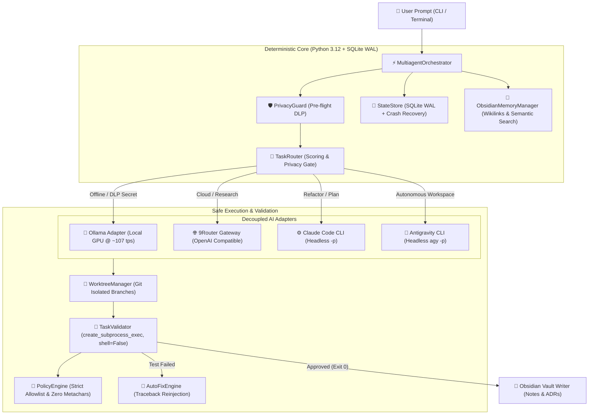

<div align="center">

# 👑 HERA Multiagent
### The Sovereign Local AI Orchestration Engine for Windows

[](https://python.org)
[-success.svg?logo=pytest&logoColor=white)](https://github.com/Kaio-Comk/hera-multiagent)
[](https://github.com/Kaio-Comk/hera-multiagent)
[](https://github.com/Kaio-Comk/hera-multiagent)
[](https://github.com/Kaio-Comk/hera-multiagent)
[](https://opensource.org/licenses/MIT)

**Connect, route, validate, and orchestrate Ollama, Claude Code CLI, Antigravity CLI, 9Router, and Obsidian as permanent memory — featuring a modern Mission Control Web/Desktop interface, deterministic guardrails, zero-shell execution, and real-time streaming feedback.**

[Key Features](#-key-features) • [Mission Control GUI](#-mission-control-web--desktop-gui) • [Architecture](#-architecture) • [Security Model](#-hardened-security-model) • [Benchmark](#-hardware-benchmark) • [Quickstart](#-quickstart) • [CLI Cheatsheet](#-cli-cheatsheet)

</div>

---

## 💡 The Core Philosophy

> **Strictly separate AI intelligence from deterministic execution.**  
> LLMs handle reasoning, planning, and code drafting. The Python/SQLite orchestrator deterministically handles task queuing, structured subprocess execution (`shell=False`), git worktree isolation, pre-flight data loss prevention (DLP), objective test runners, and atomic state recovery.  
> **No AI model can execute unrestricted shell commands or leak credentials to the cloud.**

---

## ⚡ Key Features

* **🧠 4 Decoupled AI Engines:**
  * **Ollama (Local GPU):** Blazing-fast 100% offline inference on consumer GPUs (GTX 1650 Super @ **~107 tokens/s**).
  * **9Router (Local Gateway):** OpenAI-compatible access to 800+ cloud models with automatic fallback.
  * **Claude Code CLI:** Headless non-interactive `-p` subprocess for complex codebase refactoring.
  * **Antigravity CLI (`agy`):** Headless autonomous workspace operations with full tool support.
* **🔀 Directed Acyclic Graph (DAG) Scheduler:**
  * Multi-task concurrency with **Kahn's topological sorting**.
  * Asyncio semaphore concurrency control.
  * Instant **cascade cancellation**: if a parent dependency fails, downstream tasks abort safely.
* **🌳 Isolated Git Worktrees:**
  * Concurrent coding tasks execute on isolated worktree branches, preventing file collisions.
  * Strict path containment: regex-validated task IDs preventing path traversal.
* **🛡️ Hardened Security & Pre-Flight DLP:**
  * **Zero-Shell Execution:** Replaced all shell execution with `asyncio.create_subprocess_exec` (`shell=False`) and structured `argv` parsing via `shlex`.
  * **Data Loss Prevention (`PrivacyGuard`):** Detects OpenAI, Anthropic, GitHub, AWS, JWT, and password patterns. Blocks cloud routing and **fails-closed to local Ollama** whenever secrets or offline flags are detected.
  * **Process Tree Termination:** Clean teardown of orphan process trees on Windows using `taskkill /F /T`.
* **🔁 Autonomous Self-Healing Loop:**
  * Deterministic test validation with objective exit code check (`exit code 0`).
  * Auto-fix engine reinjecting traceback and test failures back into the model (capped at 2 retries).
* **📚 Permanent Second-Brain Memory (Obsidian Vault):**
  * Reads conventions and injects context from `[[wikilinks]]`.
  * Semantic note retrieval and SHA-256 deduplication.
  * Automatically records Architectural Decision Records (ADRs) and execution logs.
* **💾 Resilient Persistence & Crash Recovery:**
  * SQLite WAL mode (`PRAGMA journal_mode = WAL;`, `foreign_keys = ON;`).
  * Startup crash recovery detecting orphaned tasks and transitioning them to `FAILED` with audit events in a single atomic transaction.
* **🖥️ Mission Control Web & Desktop Interface:**
  * FastAPI backend with full REST API and real-time WebSocket log streaming.
  * Dark-mode responsive dashboard with 5 specialized operational tabs.
  * Direct 1-click model download (`ollama pull`) with streaming progress bar.
  * Native Windows Desktop Window (`pywebview`) or browser interface.

---

## 🖥️ Mission Control (Web & Desktop GUI)

Hera is designed for both terminal power users and teams who want an intuitive graphical cockpit. You can launch the interface with a single command without installing Node.js, NPM, or complex build tools:

```powershell
# Launch in default browser (FastAPI + WebSockets on 127.0.0.1:8000)
python main.py web

# OR launch as a native Windows Desktop application (PyWebView)
python main.py gui
```

### 🌟 What you can do from Mission Control:
1. **🎨 Task Studio:** Create coding/research tasks, specify acceptance criteria, set automated test commands, and assign specific AI models or let autonomous scoring route them.
2. **🎛️ AI Engine & Model Management:**
   - Toggle **100% Offline Mode** for zero-cloud privacy.
   - Configure base URLs and select default models for Ollama, 9Router, Claude Code, and Antigravity.
   - **Download any Ollama model with 1 click:** Enter any model tag (e.g. `llama3.2`, `deepseek-r1`, `qwen2.5-coder:1.5b`) to download it directly with real-time streaming progress.
3. **📊 Real-time Hardware & VRAM Telemetry:**
   - Live GPU VRAM allocation gauge (total vs used).
   - System RAM and CPU utilization gauges.
   - Active WebSocket connections.
4. **🧠 Obsidian Vault Explorer:** Search past architectural decisions (ADRs), persistent memories, and project documentation directly from the UI.
5. **📜 Live Streaming Console & WAL History:** Real-time terminal log viewer streaming step-by-step progress, auto-fix loops, and task audit trail.

---

## 🏗️ Architecture



---

## 📊 Hardware Benchmark

Measured on budget consumer hardware (**NVIDIA GeForce GTX 1650 SUPER, 4GB VRAM GDDR6** on Windows 11):

| Model | Host | VRAM Used | Throughput | Latency | Status |
|---|---|---|---|---|---|
| **`qwen2.5-coder:1.5b`** | 100% GPU VRAM | 2,149 MiB | **106.99 tokens/sec** | 1.12s | 🟢 Production Recommended |
| **`qwen3.5:4b`** | Partial CPU Offload | 4,096 MiB | **5.30 tokens/sec** | 18.4s | 🟡 High-Precision Mode |

Run the built-in benchmark at any time:
```powershell
python main.py benchmark --model qwen2.5-coder:1.5b
```

---

## 🛡️ Hardened Security Model

Following an independent application security audit, the orchestrator implements defensive controls:

| Threat Vector | Vulnerability Addressed | Applied Protection |
|---|---|---|
| **Shell Injection** | Commands like `pytest tests; powershell ...` chaining commands | `FORBIDDEN_SHELL_CHARS` blocks all `; & \| > < $ \` ` and runs via `create_subprocess_exec(*argv, shell=False)` |
| **Cloud Credential Leak** | User prompt or vault note containing API keys sent to cloud | `PrivacyGuard` scans all payloads; if secrets are detected, routes **fail-closed to local Ollama** and aborts cloud HTTP requests |
| **Path Traversal** | Malicious `task_id` escaping directory roots (`../../`) | `TASK_ID_REGEX` (`^[a-zA-Z0-9_\-]+$`) and `Path.is_relative_to()` containment |
| **Silent Workspace Fallback**| Non-existent workspace falling back to orchestrator directory | Strict `os.path.isdir()` check; immediately fails task with security error |
| **Arbitrary Code Exec** | Unrestricted `python script.py` or `python -c` execution | Strict allowlist restricted to verified modules (`-m pytest`, `-m py_compile`, `-m unittest`) |
| **Zombie Processes** | Cancelled tasks leaving child processes on Windows | Process tree termination via `taskkill /F /T /PID` |

---

## 🚀 Quickstart

### 1. Clone & Setup
```powershell
git clone https://github.com/Kaio-Comk/hera-multiagent.git
cd hera-multiagent

python -m venv .venv
.venv\Scripts\activate

pip install -e .
pip install pytest pytest-asyncio httpx pydantic pyyaml
```

### 2. Verify Health
Ensure your local engines (Ollama on port 11434, 9Router on port 20128) and CLIs are discovered:
```powershell
python main.py health
```

### 3. Run Test Suite
```powershell
python -m pytest tests -v
# 64 passed in ~17s (100% green)
```

---

## 💻 CLI Cheatsheet

### 1. Launch Mission Control Interface
```powershell
# Web Dashboard in your browser (http://127.0.0.1:8000)
python main.py web

# Native Desktop Window
python main.py gui
```

### 2. Health Check
```powershell
python main.py health
```

### 3. Run a Coding Task with Auto-Validation
```powershell
python main.py run "Write a Python function to compute GCD with type hints" `
  --title "GCD Function" `
  --type coding `
  --agent ollama `
  --model qwen2.5-coder:1.5b `
  --criteria "Function gcd implemented" `
  --val-cmd "python -m py_compile models/task.py"
```

### 4. Run Multi-Task Parallel DAG Demo
Executes parallel tasks concurrently, cancels downstream tasks on failure, and consolidates results:
```powershell
python main.py dag-demo
```

### 5. Search Second-Brain Memory in Obsidian
```powershell
python main.py vault-search "security"
```

### 6. Benchmark Local GPU
```powershell
python main.py benchmark
```

### 7. List Recent Task History (SQLite WAL)
```powershell
python main.py list
```

---

## 📂 Project Structure

```
hera-multiagent/
├── adapters/
│   ├── antigravity.py         # Antigravity CLI adapter (agy -p headless)
│   ├── claude_code.py         # Claude Code CLI adapter (claude -p headless)
│   ├── nine_router.py         # 9Router OpenAI-compatible gateway (port 20128)
│   └── ollama.py              # Local Ollama adapter (port 11434, ~107 tps)
├── app/
│   ├── auto_fix.py            # Autonomous self-healing retry loop
│   ├── benchmark.py           # Real-time GPU & throughput profiler (nvidia-smi)
│   ├── config_manager.py      # Dynamic configuration manager (config.yaml)
│   ├── coordinator.py         # Real-time terminal progress coordinator
│   ├── dag_scheduler.py       # DAG engine (Kahn's topological sort + cancellation)
│   ├── obsidian.py            # Obsidian Vault writer (execution notes & ADRs)
│   ├── policy_engine.py       # Strict argv allowlist & zero-shell policy
│   ├── privacy_guard.py       # Pre-flight DLP & credential leak prevention
│   ├── router.py              # Privacy-first scoring matrix & fail-closed gate
│   ├── server.py              # FastAPI REST server & WebSocket log streaming
│   ├── state_store.py         # SQLite WAL persistence with atomic crash recovery
│   ├── validator.py           # Objective test runner (create_subprocess_exec)
│   ├── vault_memory.py        # Semantic memory, [[wikilinks]] & secret redaction
│   └── worktree_manager.py    # Isolated Git Worktrees for concurrent agents
├── config.yaml                # Editable configurations (offline mode, default models, URLs)
├── models/
│   ├── agent.py               # Abstract adapter protocols & telemetry
│   └── task.py                # Pydantic schemas (AgentTask, TaskStatus, AgentResult)
├── policies/
│   └── permissions.yaml       # Strict permission allowlist
├── tests/
│   ├── test_cli_adapters.py
│   ├── test_coordinator.py
│   ├── test_dag_scheduler.py
│   ├── test_hardening.py
│   ├── test_nine_router_adapter.py
│   ├── test_obsidian.py
│   ├── test_ollama_adapter.py
│   ├── test_router.py
│   ├── test_security_audit.py # Dedicated test suite verifying 13 audit vectors
│   ├── test_server.py         # REST & WebSocket API automated tests
│   ├── test_state_store.py
│   ├── test_validator.py
│   ├── test_vault_memory.py
│   └── test_worktree_manager.py
├── web/
│   └── index.html             # Responsive Dark Mode Mission Control dashboard
├── main.py                    # Unified CLI entrypoint (run, web, gui, health, etc.)
└── pyproject.toml
```

---

## 🤝 Contributing

Contributions are welcome! Please read [CONTRIBUTING.md](CONTRIBUTING.md) and ensure all 64 automated tests pass before submitting a Pull Request.

---

## 📄 License

Distributed under the **MIT License**. See [LICENSE](LICENSE) for more information.

---

<div align="center">
  <sub>Built with ❤️ by Kaio Lima & Antigravity AI. If this project helped you, please give it a ⭐!</sub>
</div>
